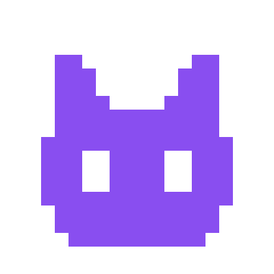

<div align="center">



<h1>dusk bot</h1>

<p><b>your own crew of ai helpers, on the chatgpt, claude, gemini or grok you already use.</b><br>
they work on their own computer, run on a schedule, and remember you and your stuff.</p>

<p>
<a href="https://github.com/DuskBotAI/duskbot/releases/latest"><b>download for mac</b></a> &nbsp;·&nbsp;
<a href="https://github.com/DuskBotAI/duskbot/releases/latest"><b>windows</b></a> &nbsp;·&nbsp;
<a href="https://github.com/DuskBotAI/duskbot/releases/latest"><b>linux</b></a> &nbsp;·&nbsp;
<a href="https://dusk.bot">dusk.bot</a> &nbsp;·&nbsp;
<a href="https://dusk.bot/docs">docs</a>
</p>

<sub>v0.2.0 "first light" · free forever for personal use · source available</sub>

</div>

<br>

<picture><source media="(prefers-color-scheme: dark)" srcset="docs/readme/hero-dark.webp"></picture>

## what it is

dusk bot is a desktop app where your ai helpers live as contacts. make a bot, give it a job in plain words, and text it like you would a friend. it does the work on a computer of its own, keeps notes on how you like things done, and stops to ask when something needs a person.

it runs on the ai you already pay for, with your own sign-in. bots, chats and files stay on your machine, or on a server you choose.

## what bots can do

| | |
| --- | --- |
| **work on their own computer** | a browser and a desktop per bot. watch it live, take the mouse for a sign-in or a captcha, hand it back. |
| **run on a schedule** | ask once and it becomes a routine: every weekday at 8, every two hours, or the moment an app event or webhook arrives. |
| **ask before the scary stuff** | real questions and risky steps come to you as a card you answer in one tap. you pick how much each bot may do alone. |
| **remember you** | every bot keeps notes on how you like things and who's who. every note is yours to read and edit. |
| **work together** | put bots in a room and they hand work to each other. you step in when one needs a yes. |
| **use your apps** | github, notion, linear, stripe and more in one click on your own account, hundreds more through composio, and any mcp server. |
| **keep secrets** | save a login once. a bot signs in with it but never sees it. 1password works too. |
| **move in** | bring bots from openclaw, hermes agent and grok bot, or from chatgpt and claude with one prompt. |
| **live in your notch** | on a mac, your bots sit in the notch: who is working, and what needs you. |

a phone app to text your bots from anywhere is coming soon.

## where bots live

| | |
| --- | --- |
| **this computer** | free, no account. bots work while it's awake. |
| **dusk cloud** | we host it. bots keep working with your laptop shut. from $20 a month. |
| **your own server** | free. one line on ubuntu or debian, and bots stay on as long as it does. |

## bring your own ai

| kind | providers |
| --- | --- |
| sign in with your plan | claude code, codex (chatgpt), gemini, grok, github copilot, cursor, kimi, qwen, opencode, hermes, cline, deepseek, droid, antigravity |
| api key | anthropic, xai, mistral, groq, cerebras, minimax, or any openai-compatible endpoint like openrouter |
| on your machine | ollama and lm studio |
| anything else | a custom acp agent or provider |

each bot can use a different model, and switching keeps its chats, files and memory. sign-in engines run their own tool loop and get dusk bot's tools (browser, computer, files, apps, memory, other bots) through an mcp server mounted for each turn. api keys and local models run in dusk bot's own loop.

## install

**mac.** one line in terminal. it downloads this mac's build of the latest release, checks it against `SHA256SUMS`, puts dusk bot in applications and opens it.

```sh
curl -fsSL https://dusk.bot/install-mac | sh
```

prefer the dmg? get it from [the latest release](https://github.com/DuskBotAI/duskbot/releases/latest) (`arm64` for apple silicon, `x64` for intel). it isn't notarized by apple yet, so the first time:

1. open dusk bot, and click **done** when macos says it can't check it.
2. open **system settings**, then **privacy & security**.
3. scroll down, click **open anyway**, and confirm.

**windows.** run `DuskBot-0.2.0-setup.exe` from [the latest release](https://github.com/DuskBotAI/duskbot/releases/latest). windows 10 or 11, 64-bit, no admin rights. if windows says it protected your pc, click **more info**, then **run anyway**.

**linux.** ubuntu 24.04, 64-bit, in beta. get the `.deb` or the `.AppImage` from [the latest release](https://github.com/DuskBotAI/duskbot/releases/latest). see the [linux guide](docs/linux-desktop.md).

```sh
sudo apt install ./DuskBot-*.deb
```

then open the app, sign in to your ai, make a bot and hand it something real. about two minutes.

## how it fits together

```text
you        desktop app · phone (soon) · a browser
             │
the link     1. direct: same machine, ssh, https, tailscale
             2. a cloudflare tunnel on your server
             3. the dusk bot relay
             end to end encrypted
             │
bot computer dusk bot server on 127.0.0.1:8799
             engines: claude code, codex, gemini, grok, ...
             tools:   browser, desktop, files, shell, apps
             data:    ~/.duskbot
             │
             your ai provider and your apps
```

- **the desktop app** (electron and react) is where you talk. it also owns the local browser views and the desktop driver.
- **the dusk bot server** (node) runs on the bot computer: this computer, dusk cloud or your own server. it owns chats, routines, approvals, the vault and the engine processes. webhooks get their own listener on the next port.
- **the link** to a remote server tries direct ways first, then the cloudflare tunnel on your server, then the dusk bot relay. frames are sealed with aes-256-gcm using a key only your app and your server hold, so the relay passes blobs it can't read. see [the link service](apps/link-service/README.md).
- **routines** run inside the server, next to the bot: `once`, `daily` on chosen weekdays, `interval` every n minutes, or `cron`, plus composio app events and `POST /hooks/<id>` webhooks. a sleeping computer runs nothing, so the desktop app keeps it awake for the hour before a due routine while plugged in, and a missed run can still start up to 12 hours late. see [routine schedules](docs/routine-schedules.md).
- **computers** are a cloud desktop on dusk cloud, a private container per bot on your server, a linux vm in docker on this computer, or your own screen on macos and ubuntu (xorg) when you turn that on. only a person can take or release control. see [computer use](docs/computer-use-integration.md).

## where your data lives

| what | where |
| --- | --- |
| bots, chats, routines, memory, files | `~/.duskbot` on the bot computer (`DUSK_DATA_DIR`), chats in sqlite |
| ai sign-ins and api keys | encrypted with the os keychain on the desktop, or a `0600` key file where there is none |
| vault logins and app tokens | encrypted files in the data folder, keys beside them as `0600` |
| backups | one file, aes-256-gcm, from a password of at least 12 characters |
| what you say to a bot | straight from the bot computer to your ai provider, not through us |
| usage information | anonymous usage counts and crash reports, never your messages or files, on until you turn off "help improve dusk bot" (first screen or Settings). The phone app sends none. [what it sends](docs/analytics.md) |

## security

- **loopback trust.** on your own computer the server trusts loopback as its owner. browsers never get that trust: a browser signs in once, and tunneled or relayed requests need a paired session.
- **pairing.** `duskbot pair` prints a single-use code that lasts 5 minutes. sessions last 30 days and renew on use. five wrong codes lock an address out for 10 minutes.
- **approvals.** each bot has a level, from ask to full access. real questions and missing sign-ins always reach you, and sending in your name has its own setting. see [approval levels](docs/approval-levels.md).
- **secrets stay out of the model.** dusk bot types a saved login in, or hands a secret to a tool, itself. values are redacted from chats and logs.
- **sandboxes.** on your server and on dusk cloud, bots run in a bubblewrap sandbox and bot desktops are separate containers. see [bot box](docs/bot-box.md).
- **what our servers see.** the link service keeps hashed verifiers, public keys and sealed blobs. phone notifications carry a bot's name, never the message.

found a problem? see [SECURITY.md](SECURITY.md).

## self-hosting

run your bots on a server you look after, so they keep working with the laptop shut. it's free. in the app, choose **add a cloud or your own server** and paste the line it gives you on ubuntu 20.04+ or debian 11+:

```sh
curl -fsSL https://dusk.bot/s/<code>/cloudflare | sh   # a cloudflare tunnel (recommended)
curl -fsSL https://dusk.bot/s/<code> | sh              # the dusk bot relay
curl -fsSL https://dusk.bot/s/<code>/tailscale | sh    # your tailnet
curl -fsSL https://dusk.bot/s/<code>/ssh | sh          # over your ssh port
```

it installs dusk bot as `duskbot.service`, links it to your app and sets up the way you picked. the line works once and expires after 30 minutes. by hand: `npx duskbot serve` on any machine with node 24+, then `npx duskbot pair`. docker compose lives in [deploy/](deploy/). never expose port 8799 directly; read [self-hosting](docs/self-hosting.md) first.

## configuration

most settings live in the app. these matter when you run the server yourself:

| variable | what it does |
| --- | --- |
| `DUSK_DATA_DIR` | the data folder. default `~/.duskbot` |
| `DUSK_PORT` | the server port. default `8799` |
| `DUSK_WEBHOOK_PORT` | the webhook listener. default the server port plus one |
| `DUSK_PUBLIC_URL` | the public address in pairing links |
| `DUSK_WEBHOOK_PUBLIC_URL` | the public address in webhook urls |
| `DUSK_LOOPBACK_TRUST` | `owner` (default), or `service` for shared servers |
| `DUSK_SIGNIN_EMAILS` | who may sign in by email on a hosted server |
| `DUSK_URL`, `DUSK_TOKEN` | where the `duskbot` cli connects, and its session |
| `DUSK_BOT_BOX` | turns the bubblewrap sandbox on or off |
| `COMPOSIO_API_KEY` | your own composio key |

## run from source

you need node 24+, pnpm 10, and one ai tool signed in, like [claude code](https://claude.com/claude-code) or [codex](https://github.com/openai/codex).

```sh
git clone https://github.com/DuskBotAI/duskbot.git
cd duskbot
pnpm install
pnpm dev:app          # the desktop app, with the server as its child
```

```sh
pnpm dev:server       # just the server, on 127.0.0.1:8799
pnpm dev              # the app in a browser, on 127.0.0.1:5199
pnpm dev:desktop      # the electron shell against a running server and vite
pnpm demo             # a separate demo workspace with sample bots, on 127.0.0.1:5299
pnpm typecheck        # types for the app and the server
pnpm lint             # oxlint
pnpm test             # the test suites
pnpm package:mac      # a dmg; also package:win and package:linux
```

more in [development](docs/development.md).

```text
src/              the app ui (react), for the desktop window and the browser
electron/         the desktop shell: windows, the notch island, updates, the desktop driver
server/           the dusk bot server: bots, engines, routines, computers, the vault
shared/           code the app and the server both use
apps/
  mobile/         the phone app (capacitor)
  companion/      the sidecar a phone talks to
  link-service/   pairing and the link for your own server
  cloudflare/     the relay and the composio broker
  dashboard/      the dusk bot account and dusk cloud dashboard
  cloud-service/  dusk cloud desktops
  site/           dusk.bot
skills/           skills that ship with the app
deploy/           docker compose and server deploy files
scripts/          build, test and demo scripts
docs/             guides and references
```

## faq

<details>
<summary><b>is it really free?</b></summary>
<br>
yes, for personal use, with every feature. you only pay for dusk cloud or a work license if you want one.
</details>

<details>
<summary><b>is it safe to let bots click around?</b></summary>
<br>
you set how much each bot may do alone, you can watch or take over at any time, and <code>⌘.</code> stops a bot at once. read the card before you tap allow, especially when it sends, buys or deletes.
</details>

<details>
<summary><b>do my bots work when my laptop is off?</b></summary>
<br>
on this computer, they work while it's awake. put them on dusk cloud or your own server and they keep going, routines included.
</details>

<details>
<summary><b>can i read and change the code?</b></summary>
<br>
yes. dusk bot is source available under the <a href="LICENSE">polyform strict license</a>: read it, run it and build it for personal use. commercial use needs a <a href="https://dusk.bot/license">separate license</a>. details in <a href="docs/LICENSING.md">licensing</a>.
</details>

<details>
<summary><b>is there a dusk bot token or coin?</b></summary>
<br>
no. dusk bot has no token, and any coin using the name has nothing to do with this project.
</details>

## contributing

bug reports, ideas and pull requests are welcome. start with [CONTRIBUTING.md](CONTRIBUTING.md) and the [code of conduct](CODE_OF_CONDUCT.md).

## license

source available under [polyform strict 1.0.0](LICENSE). free for personal use; commercial use needs a [separate license](https://dusk.bot/license).

<br>

<p align="center"><br><sub>made at dusk. the bots did most of it. <a href="https://dusk.bot">dusk.bot</a></sub></p>
