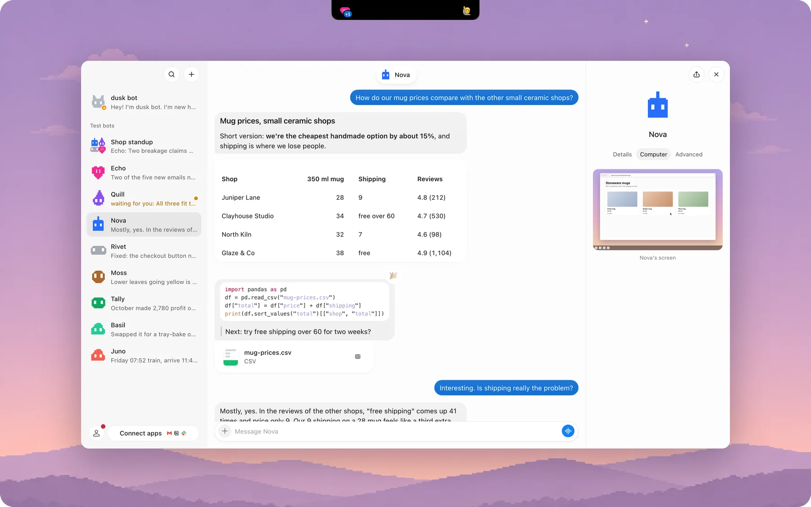
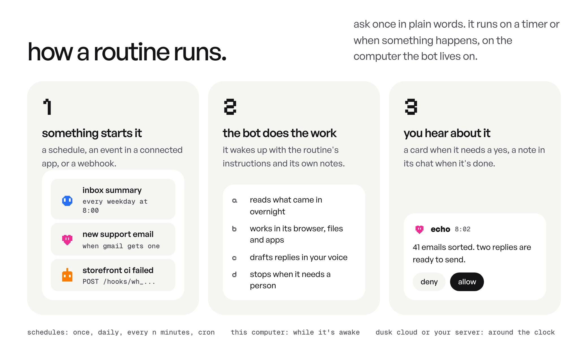
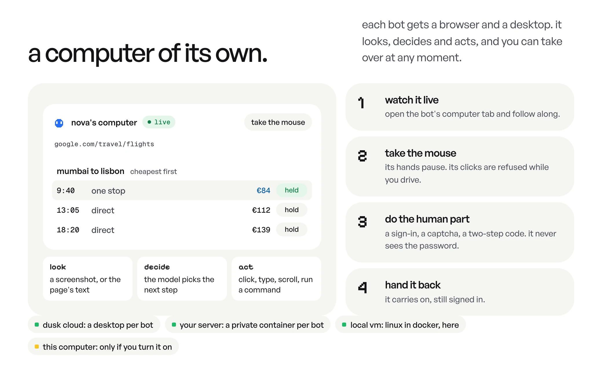
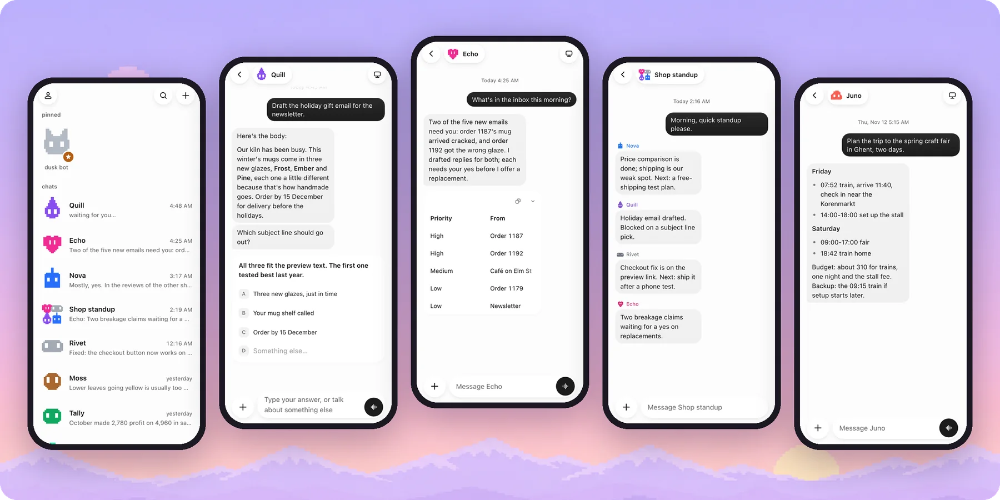
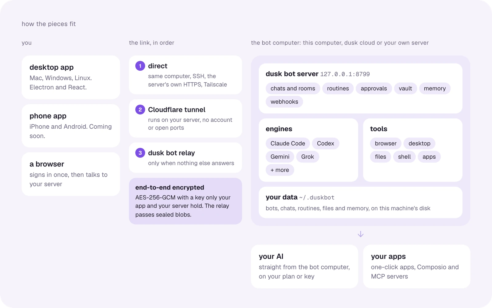

<div align="center">

# dusk bot

**Your own team of AI bots, in a chat app. Each one works on a computer of its own.**

<a href="https://github.com/DuskBotAI/duskbot/releases/latest"></a>&nbsp;<a href="https://github.com/DuskBotAI/duskbot/releases/latest"></a>&nbsp;<a href="https://github.com/DuskBotAI/duskbot/releases/latest"></a>&nbsp;<a href="https://dusk.bot"></a>

<sub>v0.2.0 "first light" &nbsp;·&nbsp; macOS 12+, Windows 10 and 11, Ubuntu 24.04 &nbsp;·&nbsp; source available, free for personal use</sub>

<br>



</div>

<br>

dusk bot is a desktop app where your AI helpers live as contacts. Make a bot, give it a job in plain words, and talk to it like you would text a friend. It works on a computer of its own, runs on a schedule, remembers how you like things done, and stops to ask you when something needs a person.

It runs on the AI you already pay for (Claude, ChatGPT, Gemini, Grok and more) with your own sign-in. Your bots, chats and files stay on your machine or on a server you choose.

## Contents

- [Features](#features)
- [Routines](#routines)
- [A computer for every bot](#a-computer-for-every-bot)
- [Tools, apps and AI models](#tools-apps-and-ai-models)
- [Phone app (coming soon)](#phone-app-coming-soon)
- [Architecture](#architecture)
- [Where your data lives](#where-your-data-lives)
- [Security model](#security-model)
- [Install](#install)
- [Self-hosting](#self-hosting)
- [Configuration](#configuration)
- [Run from source](#run-from-source)
- [Repo layout](#repo-layout)
- [Pricing](#pricing), [FAQ](#faq), [Contributing](#contributing), [License](#license)

## Features

- **Bots as contacts.** One bot, one job, one chat. Pin, hide and arrange them like any messaging app.
- **Rooms.** Put several bots in one thread and they hand work to each other.
- **Routines.** Ask once and it runs on a schedule, on an app event or on a webhook.
- **Its own computer.** A browser and a desktop per bot. Watch live, take control, hand it back.
- **Approvals.** Real questions and risky steps come to you as a card you answer in one tap.
- **Your apps.** One-click apps, hundreds more through Composio, and any MCP server.
- **Your AI.** Claude Code, Codex, Gemini, Grok and more, a different model per bot.
- **Vault.** Logins and secrets a bot can use but never see. 1Password works too.
- **Memory and skills.** Notes you can read and edit, and skills a bot can learn and reuse.
- **Bring your bots.** Move in from OpenClaw, Hermes Agent and Grok bot, or from ChatGPT and Claude with one prompt.
- **Notch island.** On a Mac, your bots live in the notch: who is working, what needs you.

## Routines

<picture>
  <source media="(prefers-color-scheme: dark)" srcset="docs/readme/routines-dark.webp">
  
</picture>

- **Triggers.** A schedule (`once`, `daily` at a time on chosen weekdays, `interval` every N minutes inside a window, or `cron`), an event from a connected app, or a webhook at `POST /hooks/<id>` on the webhook port.
- **Where it runs.** The scheduler lives inside the dusk bot server, next to the bot. There is no outside scheduler.
- **Sleep.** A computer that is asleep runs nothing. While plugged in, the desktop app keeps the computer awake for the hour before a due routine and while one runs. A missed run can still start up to 12 hours late. On dusk cloud or your own server, routines run around the clock.

More in [docs/routine-schedules.md](docs/routine-schedules.md) and [docs/proactive-routines.md](docs/proactive-routines.md).

## A computer for every bot

<picture>
  <source media="(prefers-color-scheme: dark)" srcset="docs/readme/computer-dark.webp">
  
</picture>

- **Browser.** Every bot has a bundled browser (agent-browser with Chromium) it can read and drive.
- **Desktop.** For anything with no API, a bot gets a full desktop: a cloud desktop on dusk cloud, a private container per bot on your own server, an isolated Linux VM in Docker on this computer, or your own screen on macOS and Ubuntu (Xorg) when you turn that on.
- **Take control.** Only a person can take or release control. While you hold it, the bot's actions are refused, so you can do a sign-in or a captcha and hand back a signed-in session.

More in [docs/computer-use-integration.md](docs/computer-use-integration.md) and [docs/byo-vps.md](docs/byo-vps.md).

## Tools, apps and AI models

### How a bot runs

Each bot runs on an **engine**. Sign-in engines are the AI tools you already use (Claude Code, Codex, Gemini CLI and others). They run their own tool loop, and dusk bot hands them its tools (browser, computer, files, apps, memory, other bots) through an MCP server it mounts for each turn. For API keys and local models, dusk bot runs the tool loop itself.

### Supported AI

| Kind | Providers |
| --- | --- |
| Sign in with your plan | Claude Code, Codex (ChatGPT), Gemini, Grok, GitHub Copilot, Cursor, Kimi, Qwen, OpenCode, Hermes, Cline, DeepSeek, Droid, Antigravity |
| API key | Anthropic, xAI, Mistral, Groq, Cerebras, MiniMax, and any OpenAI-compatible endpoint such as OpenRouter |
| Your own machine | Ollama and LM Studio |
| Anything else | A custom ACP agent or a custom provider |

Each bot can use a different model. Switching keeps its chats, files and memory.

### Connect your apps

- **One click, on your own account:** GitHub, Notion, Linear, Airtable, Todoist, Trello, ClickUp, HubSpot, Jira, Shopify, Stripe and Cloudflare, plus Gmail with an app password. Tokens are encrypted on the bot computer.
- **Composio:** hundreds more apps with your own Composio key, including app events for routines. See [docs/composio.md](docs/composio.md).
- **MCP servers:** add any server by URL (Streamable HTTP or SSE) or as a local command. See [docs/custom-mcp-servers.md](docs/custom-mcp-servers.md).
- **dusk bot as an MCP server:** `duskbot mcp` lets another agent talk to your bots. It cannot approve, delete or change credentials. See [docs/mcp-server.md](docs/mcp-server.md).

You choose which bots may use each app.

## Phone app (coming soon)



Text your bots from your phone, answer their questions and approve things from anywhere. The app pairs with your computer or your cloud by scanning a code. It is on its way to the App Store and Google Play.

## Architecture

<picture>
  <source media="(prefers-color-scheme: dark)" srcset="docs/readme/arch-dark.webp">
  
</picture>

- **The desktop app** (Electron and React) is where you talk. It also owns the local browser views and the desktop driver.
- **The dusk bot server** (Node) runs on the bot computer and listens on `127.0.0.1:8799`. It owns chats, routines, approvals, the vault and the engine processes. Webhooks get their own listener on the next port.
- **The bot computer** is this computer, dusk cloud, or your own server.
- **The link** from the app to a remote server tries direct ways first (SSH, the server's own HTTPS, Tailscale), then the Cloudflare tunnel on your server, then the dusk bot relay. Frames are sealed with AES-256-GCM using a key only your app and your server hold, so the relay passes blobs it cannot read. See [apps/link-service](apps/link-service/README.md).

## Where your data lives

| What | Where |
| --- | --- |
| Bots, chats, routines, memory, files | `~/.duskbot` on the bot computer (`DUSK_DATA_DIR`), with chats in SQLite |
| Engine sign-ins and API keys | Encrypted with the OS keychain on the desktop, or a `0600` key file where there is no keychain |
| Vault logins and app tokens | Encrypted files in the data folder, with their keys beside them as `0600` |
| Backups | One file, AES-256-GCM, from a password of at least 12 characters |
| Your messages to the AI | Sent from the bot computer straight to your provider, not through us |
| Usage information | Nothing leaves your computer unless you turn on "help improve dusk bot". No third-party analytics SDK. See [what it sends](docs/analytics.md). |

## Security model

- **Loopback trust.** On your own computer, the server trusts loopback as its owner. Browsers never get that trust: a browser signs in once, and tunneled or relayed requests need a paired session.
- **Pairing.** `duskbot pair` prints a single-use code that lasts 5 minutes. Sessions last 30 days and renew on use. Five wrong codes lock an address out for 10 minutes.
- **Approvals.** Each bot has an approval level, from Ask to Full access. Real questions and missing sign-ins always reach you, and sending in your name (email, posts, payments) has its own setting. See [docs/approval-levels.md](docs/approval-levels.md).
- **Secrets stay out of the model.** dusk bot types a saved login in or hands a secret to a tool itself. Values are redacted from chats and logs.
- **Sandboxes.** On your own server and on dusk cloud, bots run in a bubblewrap sandbox, and bot desktops are separate containers. See [docs/bot-box.md](docs/bot-box.md).
- **What our servers see.** The link service keeps hashed verifiers, public keys and sealed blobs. Phone notifications carry a bot's name, never the message.

Found a problem? See [SECURITY.md](SECURITY.md).

## Install

### Mac

```sh
curl -fsSL https://dusk.bot/install-mac | sh
```

It downloads this Mac's build of the latest release, checks it against the release's `SHA256SUMS`, puts dusk bot in Applications and opens it.

Prefer the DMG? Get it from [the latest release](https://github.com/DuskBotAI/duskbot/releases/latest) (`arm64` for Apple silicon, `x64` for Intel). The app isn't notarized by Apple yet, so the first time:

1. Open dusk bot, and click **Done** when macOS says it can't check it.
2. Open **System Settings**, then **Privacy & Security**.
3. Scroll down, click **Open Anyway**, and confirm.

### Windows

Download `DuskBot-0.2.0-setup.exe` from [the latest release](https://github.com/DuskBotAI/duskbot/releases/latest) and run it. Windows 10 or 11, 64-bit, no admin rights needed. If Windows says it protected your PC, click **More info**, then **Run anyway**.

### Linux

Ubuntu 24.04, 64-bit, in beta. Get the `.deb` or the `.AppImage` from [the latest release](https://github.com/DuskBotAI/duskbot/releases/latest).

```sh
sudo apt install ./DuskBot-*.deb
```

See the [Linux guide](docs/linux-desktop.md).

## Self-hosting

Run your bots on a server you look after, so they keep working with your laptop shut. It's free.

**From the app.** Choose **add a cloud or your own server** and paste the line it gives you on Ubuntu 20.04+ or Debian 11+:

```sh
curl -fsSL https://link.dusk.bot/i/<code> | sh -s -- --cloudflare   # a Cloudflare tunnel (recommended)
curl -fsSL https://link.dusk.bot/i/<code> | sh                      # the dusk bot relay
curl -fsSL https://link.dusk.bot/i/<code> | sh -s -- --tailscale    # your tailnet
curl -fsSL https://link.dusk.bot/i/<code> | sh -s -- --ssh          # over your SSH port
```

It installs dusk bot as a systemd service (`duskbot.service`), links it to your app and sets up the way you picked. The line works once and expires after 30 minutes.

**By hand.** `npx duskbot serve` on any machine with Node 24+, then `npx duskbot pair` for a pairing code. A Docker Compose setup lives in [deploy/](deploy/).

Never expose port 8799 directly. Read [docs/self-hosting.md](docs/self-hosting.md) and [docs/deploy-vps.md](docs/deploy-vps.md) first.

## Configuration

Most settings live in the app. These environment variables matter when you run the server yourself:

| Variable | What it does |
| --- | --- |
| `DUSK_DATA_DIR` | The data folder. Default `~/.duskbot`. |
| `DUSK_PORT` | The server port. Default `8799`. |
| `DUSK_WEBHOOK_PORT` | The webhook listener. Default the server port plus one. |
| `DUSK_PUBLIC_URL` | The public address used in pairing links. |
| `DUSK_WEBHOOK_PUBLIC_URL` | The public address used in webhook URLs. |
| `DUSK_LOOPBACK_TRUST` | `owner` (default) or `service` for shared servers. |
| `DUSK_SIGNIN_EMAILS` | Who may sign in by email on a hosted server. |
| `DUSK_URL`, `DUSK_TOKEN` | Where the `duskbot` CLI connects, and its session. |
| `DUSK_BOT_BOX` | Turns the bubblewrap sandbox on or off. |
| `COMPOSIO_API_KEY` | Your own Composio key. |

## Run from source

You need Node 24+, pnpm 10, and at least one AI tool signed in, such as [Claude Code](https://claude.com/claude-code) or [Codex](https://github.com/openai/codex).

```sh
git clone https://github.com/DuskBotAI/duskbot.git
cd duskbot
pnpm install
pnpm dev:app          # the desktop app, with the server as its child
```

| Command | What it does |
| --- | --- |
| `pnpm dev:server` | Just the server, on `127.0.0.1:8799` |
| `pnpm dev` | The app in a browser, on `127.0.0.1:5199` |
| `pnpm dev:desktop` | The Electron shell against a running server and Vite |
| `pnpm demo` | A separate demo workspace with sample bots, on `127.0.0.1:5299` |
| `pnpm typecheck` | Types for the app and the server |
| `pnpm lint` | oxlint |
| `pnpm test` | The test suites |
| `pnpm package:mac` | A DMG; also `package:win` and `package:linux` |

More in [docs/development.md](docs/development.md) and [docs/demo.md](docs/demo.md).

## Repo layout

```text
src/              the app UI (React), for the desktop window and the browser
electron/         the desktop shell: windows, the notch island, updates, the desktop driver
server/           the dusk bot server: bots, engines, routines, computers, the vault
shared/           code the app and the server both use
apps/
  mobile/         the phone app (Capacitor)
  companion/      the sidecar a phone talks to
  link-service/   pairing and the link for your own server
  cloudflare/     the relay and the Composio broker
  dashboard/      the dusk bot account and dusk cloud dashboard
  cloud-service/  dusk cloud desktops
  site/           dusk.bot
skills/           skills that ship with the app
deploy/           Docker Compose and server deploy files
scripts/          build, test and demo scripts
docs/             guides and references
```

## Pricing

**Free forever for personal use.** Every feature, on your own computer or your own server. No card, no account.

- **Bring your own AI.** You pay your AI provider on the plan or key you already have. dusk bot never bills you for AI.
- **Bring your own Composio key** for the long tail of apps. The one-click apps are free on your own account.
- **dusk cloud is optional.** Plus ($20 a month) keeps your bots working with your laptop shut. Pro ($50 a month) is a bigger machine and includes a work license.

Using dusk bot at or for a business needs a work license. See [pricing](https://dusk.bot/pricing).

## FAQ

<details>
<summary><b>Is it really free?</b></summary>
<br>
Yes, for personal use, with every feature. You only pay for dusk cloud or a work license if you want one.
</details>

<details>
<summary><b>Is it safe to let bots click around?</b></summary>
<br>
You set how much each bot may do alone, you can watch or take over at any time, and <code>⌘.</code> stops a bot at once. You are responsible for what you approve, so read the card before you tap allow.
</details>

<details>
<summary><b>Do my bots work when my laptop is off?</b></summary>
<br>
On this computer, they work while it is awake. Put them on dusk cloud or your own server and they keep going, routines included.
</details>

<details>
<summary><b>Can I read and change the code?</b></summary>
<br>
Yes. dusk bot is source available under the <a href="LICENSE">PolyForm Strict License</a>: you can read it, run it and build it for personal use. Commercial use needs a <a href="https://dusk.bot/license">separate license</a>. Details in <a href="docs/LICENSING.md">LICENSING</a>.
</details>

<details>
<summary><b>Is there a dusk bot token or coin?</b></summary>
<br>
No. dusk bot has no token, and any coin using the name has nothing to do with this project.
</details>

## Contributing

Bug reports, ideas and pull requests are welcome. Start with [CONTRIBUTING.md](CONTRIBUTING.md) and the [code of conduct](CODE_OF_CONDUCT.md).

## License

Source available under [PolyForm Strict 1.0.0](LICENSE). Free for personal use; commercial use needs a [separate license](https://dusk.bot/license). Security reports go to [SECURITY.md](SECURITY.md).

<br>

<div align="center"><sub>made at dusk · <a href="https://dusk.bot">dusk.bot</a> · hello@dusk.bot</sub></div>
