<div align="center">

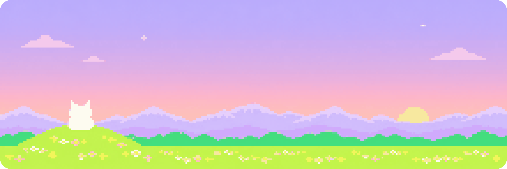

# dusk bot

**Your own team of AI bots, in a chat app. Each one works on a computer of its own.**

<a href="https://github.com/DuskBotAI/duskbot/releases/latest"></a>&nbsp;<a href="https://github.com/DuskBotAI/duskbot/releases/latest"></a>&nbsp;<a href="https://github.com/DuskBotAI/duskbot/releases/latest"></a>&nbsp;<a href="https://dusk.bot"></a>

<sub>v0.2.0 "first light" &nbsp;·&nbsp; macOS 12+, Windows 10 and 11, Ubuntu 24.04 &nbsp;·&nbsp; free for personal use</sub>

<br><br>

<picture>
  <source media="(prefers-color-scheme: dark)" srcset="docs/readme/hero-dark.webp">
  
</picture>

<br>

[What it is](#what-it-is) · [Features](#features) · [How it works](#how-it-works) · [Install](#install) · [Run from source](#run-from-source) · [Pricing](#pricing) · [FAQ](#faq)

</div>

## What it is

dusk bot is a desktop app where your AI helpers live as contacts. You make a bot, give it a job in plain words, and talk to it like you would text a friend. It does the work on a computer of its own, remembers how you like things done, and asks before anything risky.

It runs on the AI you already use (Claude, ChatGPT, Gemini, Grok and more), with your own sign-in. Your bots, chats and files stay on your machine, or on a server you choose.

## Features

### 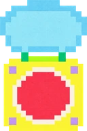 Bots that act on their own, and ask first

A bot picks up a job and works through it on its own. When it needs a decision, it stops and asks with a card you answer in one tap.

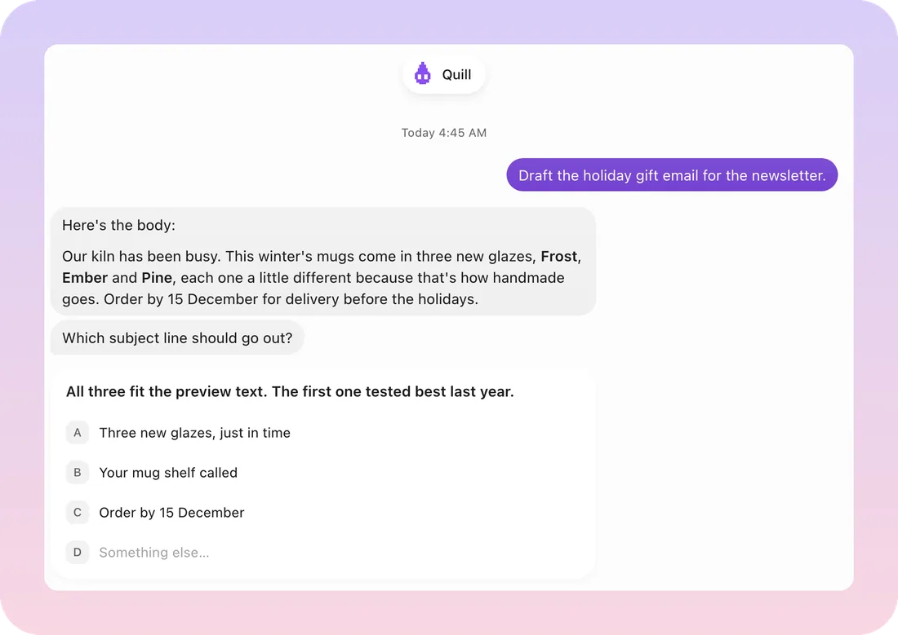

You choose how much each bot may do without asking: ask for everything, accept file edits, let the AI's own review approve routine steps, or full access. Sending in your name (email, posts, payments) is a separate switch.

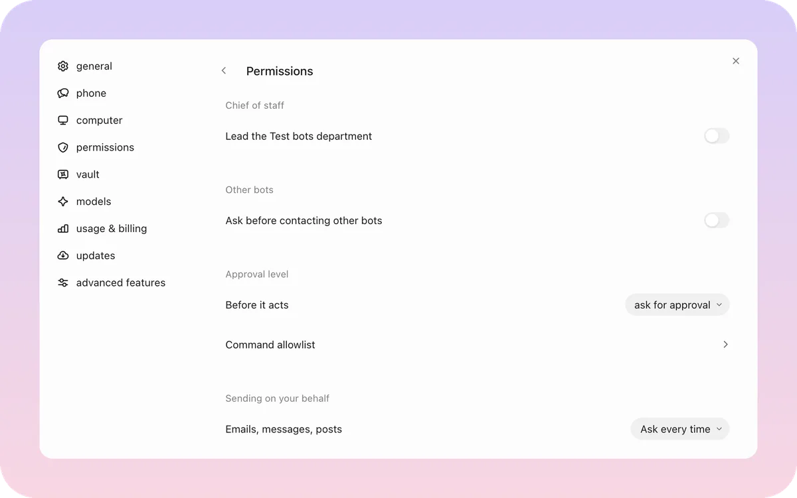

### 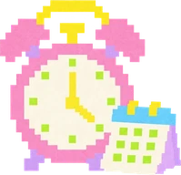 Routines

Ask once and it becomes a routine. It runs on a schedule, or the moment another app sends something.

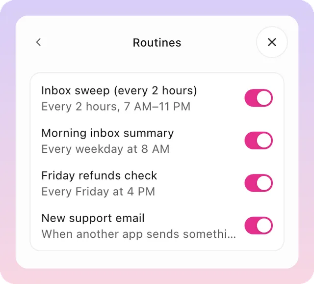

### 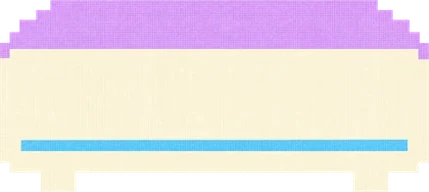 A computer for every bot

Each bot gets a screen of its own to browse, sign in and click through. Pick where your bots live: this computer, dusk cloud (hosted by us, works with your laptop shut), or your own server with one pasted line.

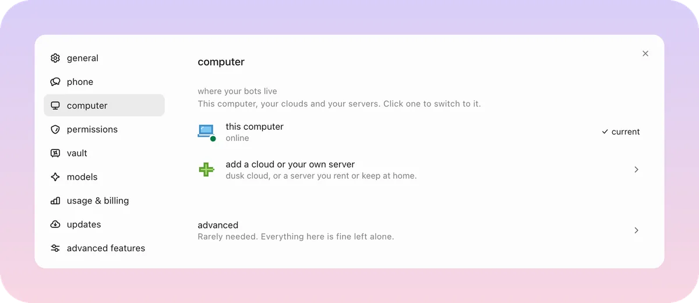

### 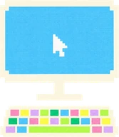 Watch and take over

Open a bot's computer to watch it live. Take control to click and type yourself (a sign-in, a captcha, a two-step code), then hand it back. The bot stays signed in and never sees the password.

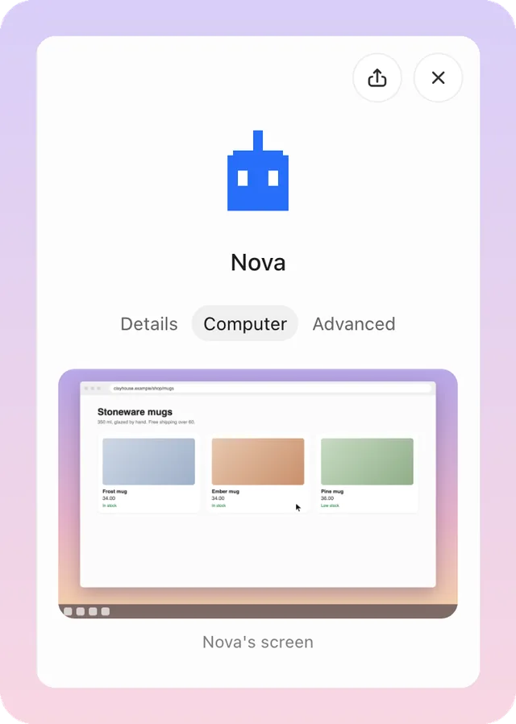

### 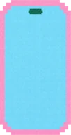 Phone app and the notch island

Text your bots from your phone. Pair once by scanning a code; answer questions and approve things from anywhere.

<picture>
  <source media="(prefers-color-scheme: dark)" srcset="docs/readme/phone-dark.webp">
  
</picture>

On a Mac, your bots also live in the notch. Hover to see who is working, answer a question or allow a command without opening the app.

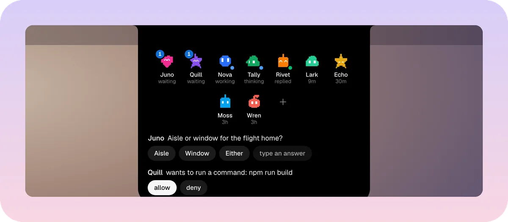

### 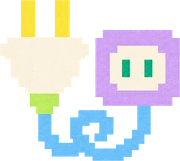 Connect your apps

Connect an app once and pick which bots may use it. GitHub, Notion, Linear, Gmail, Stripe, Shopify and more connect in one click on your own account. Hundreds more come through [Composio](https://composio.dev) with your own key, and you can add any MCP server.

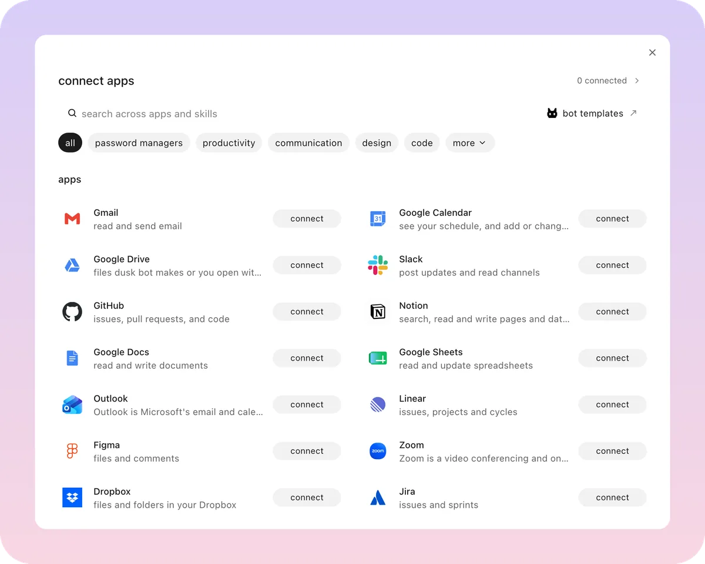

### 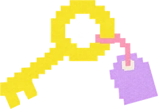 Vault

Save a login or a secret once. Bots sign in with it without ever seeing it: dusk bot types it in or hands it to a tool, so the value never reaches the AI. 1Password works too.

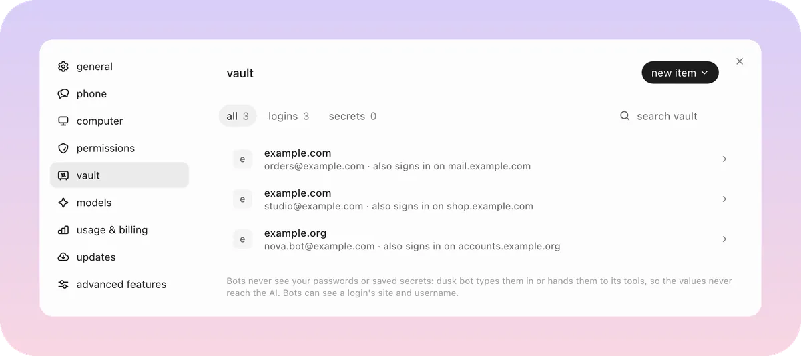

### 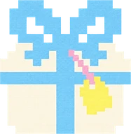 Bring your bots with you

Move in from OpenClaw, Hermes Agent and Grok bot, with their skills and memories. From ChatGPT or Claude, copy one prompt in and drop the answer back here. Nothing changes in the app you came from.

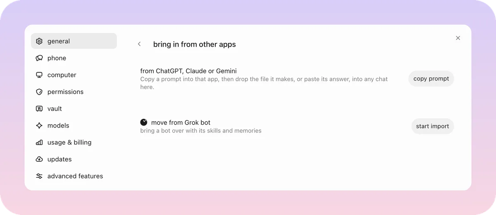

###  Bring your own AI

Sign in once with the AI you pay for and every bot can use it. Give each bot a different model and swap any time; it keeps its chats, files and memory. An API key or a model you run yourself works too.

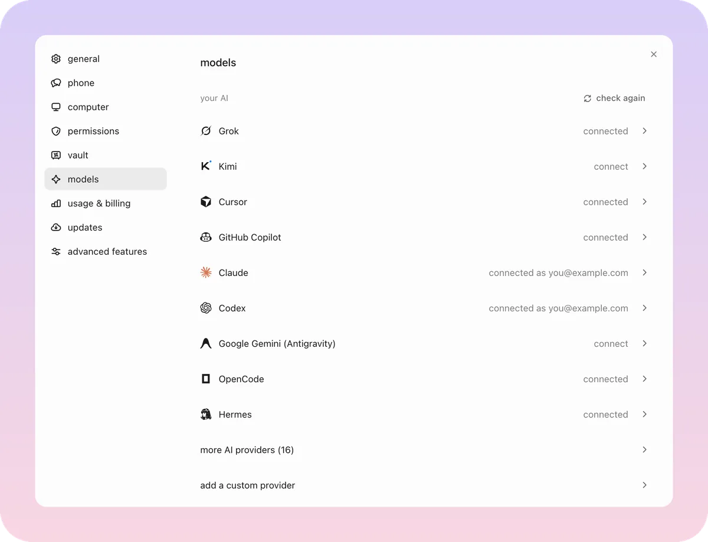

### 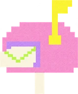 Private by default

- Bots, chats, files and memory live on your disk in `~/.duskbot`, or on your own cloud or server.
- What you say goes straight from your machine to your AI provider, not through us.
- Keys and sign-ins stay on the machine your bots run on and are never shown again after you save them.
- Phone notifications carry the bot's name, never the message.
- No third-party analytics SDK, and no usage information leaves your computer unless you turn on "help improve dusk bot" ([what it sends](docs/analytics.md)). Backups are encrypted with a password only you know.

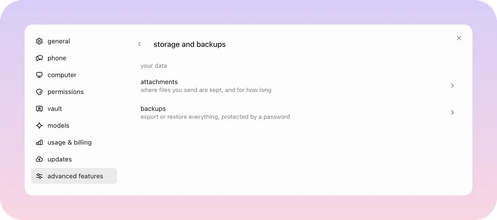

### And also

Rooms where several bots hand work to each other, memory you can read and edit, skills, voice, files, and a team of bots that all work at the same time.

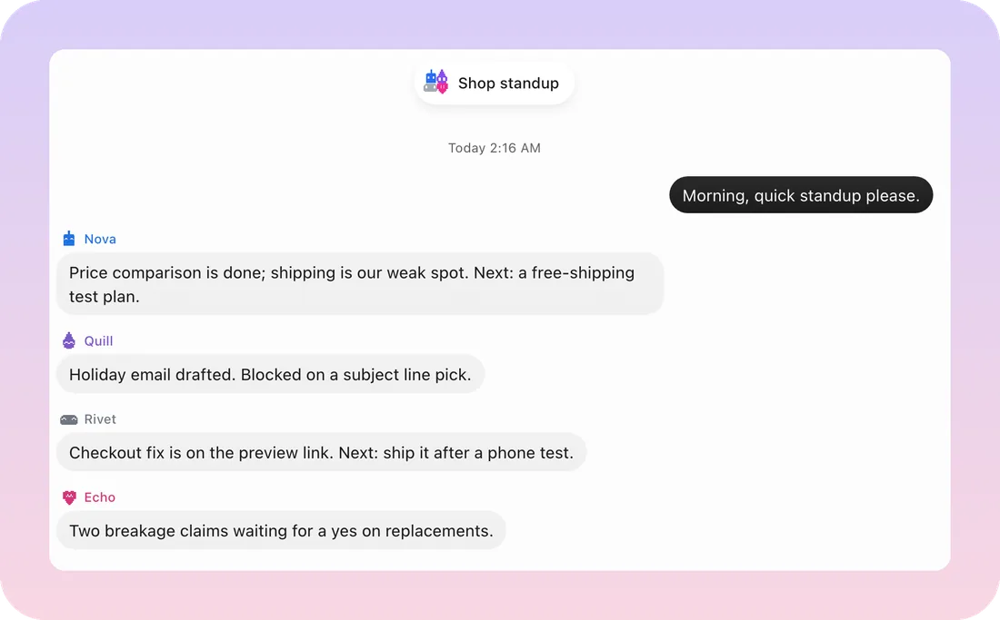

## How it works

The app is where you talk. The bot computer is where the work happens: this computer, dusk cloud or your own server. The app reaches it the most direct way it can.

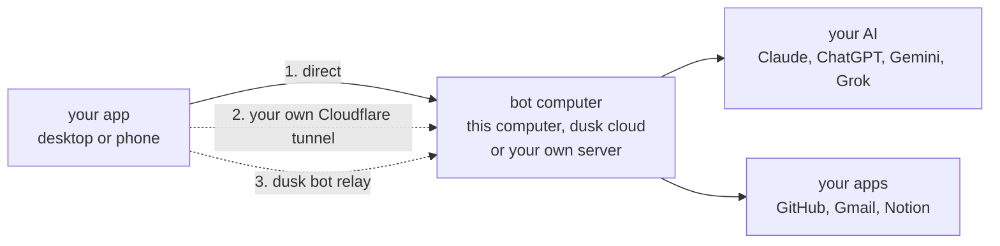

1. **Direct** first: same computer, your network, Tailscale or SSH.
2. If that can't connect, **your own Cloudflare tunnel**, with no account, domain or open ports.
3. Only then, the **dusk bot relay**. It carries the connection and switches back to direct as soon as a direct way answers.

Bots run the AI tools you already signed in to (Claude Code, Codex and others) on the bot computer, so your plan and your login do the work.

## Install

### Mac

The quickest way, one line in Terminal:

```sh
curl -fsSL https://dusk.bot/install-mac | sh
```

It downloads this Mac's build of the latest release, checks it against the release's SHA256SUMS, puts dusk bot in Applications and opens it.

Prefer the DMG? Download it from [the latest release](https://github.com/DuskBotAI/duskbot/releases/latest) (`arm64` for Apple silicon, `x64` for Intel). The app isn't notarized by Apple yet, so the first time:

1. Open dusk bot, and click **Done** when macOS says it can't check it.
2. Open **System Settings**, then **Privacy & Security**.
3. Scroll down, click **Open Anyway**, and confirm.

### Windows

Download `DuskBot-0.2.0-setup.exe` from [the latest release](https://github.com/DuskBotAI/duskbot/releases/latest) and run it. Windows 10 or 11, 64-bit, no admin rights needed. If Windows says it protected your PC, click **More info**, then **Run anyway**.

### Linux

Ubuntu 24.04, 64-bit, in beta. Download the `.deb` or the `.AppImage` from [the latest release](https://github.com/DuskBotAI/duskbot/releases/latest).

```sh
sudo apt install ./DuskBot-*.deb
```

Or make the AppImage executable with `chmod +x` and run it. See the [Linux guide](docs/linux-desktop.md).

### Then

Open the app, sign in to your AI, make a bot and hand it something real. About two minutes. Every release lists each file's SHA-256 in `SHA256SUMS` if you want to check a download.

## Run from source

You need Node 24+ and pnpm, and at least one AI tool such as [Claude Code](https://claude.com/claude-code) or [Codex](https://github.com/openai/codex) signed in.

```sh
git clone https://github.com/DuskBotAI/duskbot.git
cd duskbot
pnpm install
pnpm dev:app        # the app in a desktop window, with the local server as its child
```

Other ways to run it:

```sh
pnpm dev:server     # just the server, on 127.0.0.1:8799
pnpm dev            # the app in a browser, on 127.0.0.1:5199
pnpm demo           # a separate demo workspace with sample bots, on 127.0.0.1:5299
```

Checks and builds:

```sh
pnpm typecheck
pnpm lint
pnpm test
pnpm package:mac    # or package:win, package:linux
```

More in [docs/development.md](docs/development.md) and [docs/demo.md](docs/demo.md).

## Project layout

```text
src/          the app UI (React), shared by desktop and browser
electron/     the desktop shell: windows, the notch island, updates
server/       the local server that runs bots, routines and computers
shared/       code the app and the server both use
apps/
  mobile/     the phone app
  site/       dusk.bot
  dashboard/  the dusk bot account and dusk cloud dashboard
  link-service/  pairing and the relay for your own server
  companion/  the sidecar a phone talks to
skills/       skills that ship with the app
scripts/      build, test and demo scripts
docs/         guides and references
```

## Pricing

**Free forever for personal use.** Every feature, on your own computer or your own server. No card, no account.

- **Bring your own AI.** You pay your AI provider on the plan or key you already have. dusk bot never bills you for AI.
- **Bring your own Composio key** for the long tail of apps. The one-click apps are free on your own account.
- **dusk cloud is optional.** Plus ($20 a month) keeps your bots working with your laptop shut. Pro ($50 a month) is a bigger machine and includes a work license.

Using dusk bot at or for a business needs a work license. See [pricing](https://dusk.bot/pricing) and the [license](LICENSE).

## FAQ

<details>
<summary><b>Is it really free?</b></summary>
<br>
Yes, for personal use, with every feature. You only pay for dusk cloud or a work license if you want one.
</details>

<details>
<summary><b>Which AI does it use?</b></summary>
<br>
The ones you already have: Claude, ChatGPT, Gemini, Grok, Cursor, GitHub Copilot, Kimi, OpenCode and more, or an API key, or a model you run yourself. Each bot can use a different one.
</details>

<details>
<summary><b>Is it safe to let bots click around?</b></summary>
<br>
Bots ask before the risky things: sending, buying, deleting. You set how much each bot may do alone, you can watch or take over at any time, and <code>⌘.</code> stops a bot at once. You are responsible for what you approve, so read the card before you tap allow.
</details>

<details>
<summary><b>Do my bots work when my laptop is off?</b></summary>
<br>
On this computer, they work while it is awake. Put them on dusk cloud or your own server and they keep going, routines included.
</details>

<details>
<summary><b>Can I run it on my own server?</b></summary>
<br>
Yes, and it is free. In the app, choose <b>add a cloud or your own server</b> and paste the one line it gives you on Ubuntu 20.04+ or Debian 11+. See <a href="docs/self-hosting.md">self-hosting</a>.
</details>

<details>
<summary><b>Is it open source?</b></summary>
<br>
It is source-available under the <a href="LICENSE">PolyForm Strict License</a>: you can read, run and learn from the code for personal use. Commercial use needs a <a href="https://dusk.bot/license">separate license</a>. Details in <a href="docs/LICENSING.md">LICENSING</a>.
</details>

<details>
<summary><b>Is there a dusk bot token or coin?</b></summary>
<br>
No. dusk bot has no token, and any coin using the name has nothing to do with this project.
</details>

## Contributing

Bug reports, ideas and pull requests are welcome. Start with [CONTRIBUTING.md](CONTRIBUTING.md) and the [code of conduct](CODE_OF_CONDUCT.md).

## Security

Please report security problems privately, as described in [SECURITY.md](SECURITY.md), or write to security@dusk.bot.

## License

[PolyForm Strict 1.0.0](LICENSE). Free for personal use; commercial use requires a [separate license](https://dusk.bot/license).

<br>

<div align="center">

<br>
<sub>made at dusk. <a href="https://dusk.bot">dusk.bot</a> · hello@dusk.bot</sub>
</div>
