<div align="center">

<picture><source media="(prefers-color-scheme: dark)" srcset="docs/readme/header-dark.webp">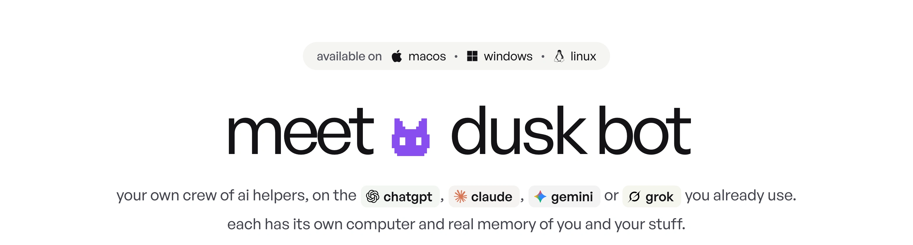</picture>

<a href="https://github.com/DuskBotAI/duskbot/releases/latest"></a><a href="https://github.com/DuskBotAI/duskbot/releases/latest"></a>
<a href="https://github.com/DuskBotAI/duskbot/releases/latest"></a><a href="https://github.com/DuskBotAI/duskbot/releases/latest"></a>
<a href="https://github.com/DuskBotAI/duskbot/releases/latest"></a><a href="https://github.com/DuskBotAI/duskbot/releases/latest"></a>
<a href="https://dusk.bot"></a><a href="https://dusk.bot"></a>

<picture><source media="(prefers-color-scheme: dark)" srcset="docs/readme/hint-dark.webp"></picture>

</div>

<picture><source media="(prefers-color-scheme: dark)" srcset="docs/readme/hero-dark.webp">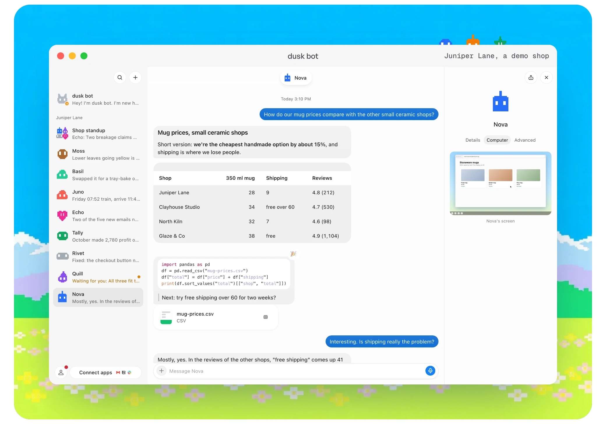</picture>

<picture><source media="(prefers-color-scheme: dark)" srcset="docs/readme/say-dark.webp">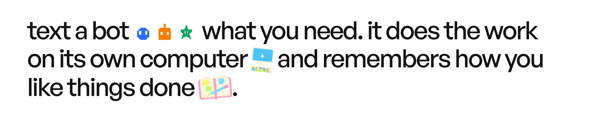</picture>

<p align="center"><sub><a href="#install">install</a> · <a href="#how-it-fits-together">how it fits together</a> · <a href="#where-your-data-lives">your data</a> · <a href="#security">security</a> · <a href="#self-hosting">self-hosting</a> · <a href="#configuration">configuration</a> · <a href="#run-from-source">run from source</a> · <a href="#faq">faq</a></sub></p>

<br>

<picture><source media="(prefers-color-scheme: dark)" srcset="docs/readme/many-dark.webp">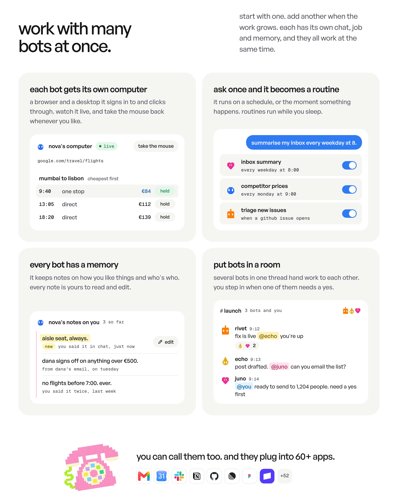</picture>

<picture><source media="(prefers-color-scheme: dark)" srcset="docs/readme/routines-dark.webp"></picture>

routines run inside the dusk bot server, next to the bot: `once`, `daily` on chosen weekdays, `interval` every n minutes inside a window, or `cron`. app events come through composio, and webhooks land on `POST /hooks/<id>` on the webhook port. a sleeping computer runs nothing, so while it's plugged in the desktop app keeps it awake for the hour before a due routine, and a missed run can still start up to 12 hours late. more in [routine schedules](docs/routine-schedules.md).

<picture><source media="(prefers-color-scheme: dark)" srcset="docs/readme/computer-dark.webp"></picture>

every bot has a bundled browser (agent-browser with chromium). for anything without an api it gets a full desktop: a cloud desktop on dusk cloud, a private container per bot on your server, a linux vm in docker on this computer, or your own screen on macos and ubuntu (xorg) when you turn that on. only a person can take or release control, and the bot's actions are refused while you hold it. more in [computer use](docs/computer-use-integration.md).

<picture><source media="(prefers-color-scheme: dark)" srcset="docs/readme/where-dark.webp">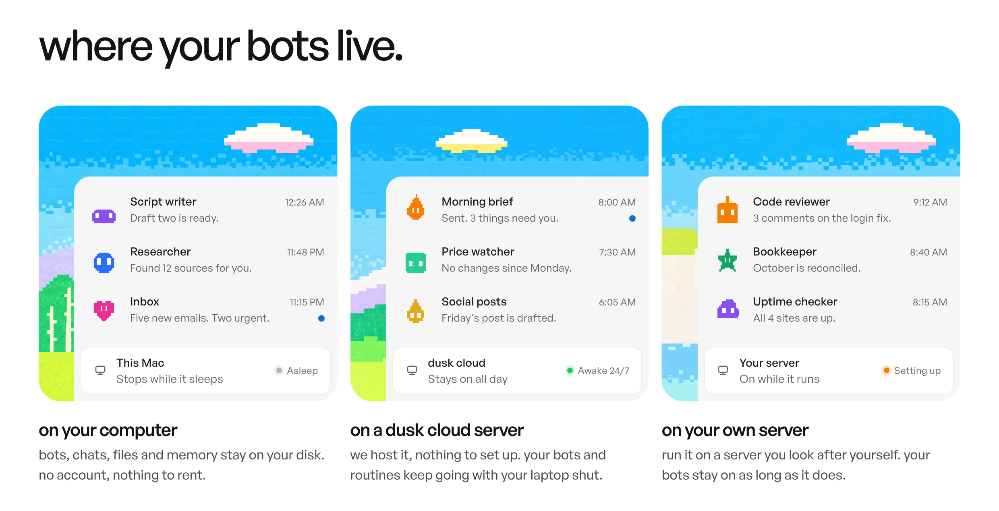</picture>

<picture><source media="(prefers-color-scheme: dark)" srcset="docs/readme/ai-dark.webp">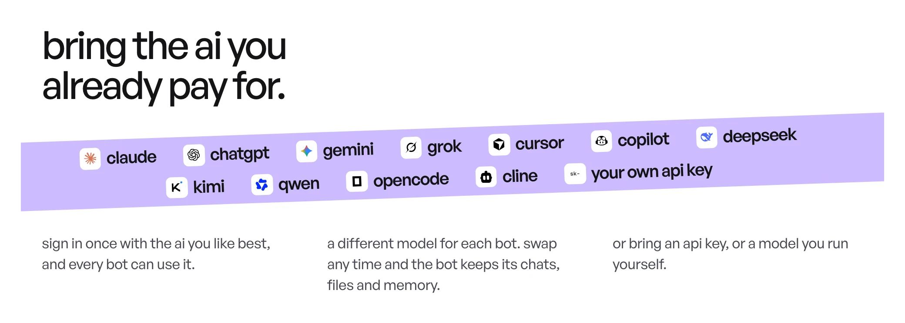</picture>

sign-in engines (claude code, codex, gemini, grok, copilot, cursor, kimi, qwen, opencode, hermes, cline, deepseek, droid, antigravity) run their own tool loop, and dusk bot hands them its tools through an mcp server it mounts for each turn. api keys (anthropic, xai, mistral, groq, cerebras, minimax, or any openai-compatible endpoint like openrouter) and local models (ollama, lm studio) run in dusk bot's own loop. a custom acp agent or provider works too.

<picture><source media="(prefers-color-scheme: dark)" srcset="docs/readme/tools-dark.webp">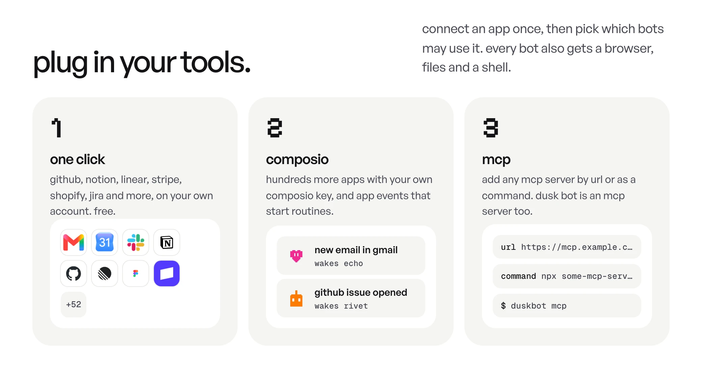</picture>

one click covers github, notion, linear, airtable, todoist, trello, clickup, hubspot, jira, shopify, stripe and cloudflare, plus gmail with an app password. tokens are encrypted on the bot computer. see [composio](docs/composio.md), [custom mcp servers](docs/custom-mcp-servers.md) and [dusk bot as an mcp server](docs/mcp-server.md).

<picture><source media="(prefers-color-scheme: dark)" srcset="docs/readme/phone-dark.webp">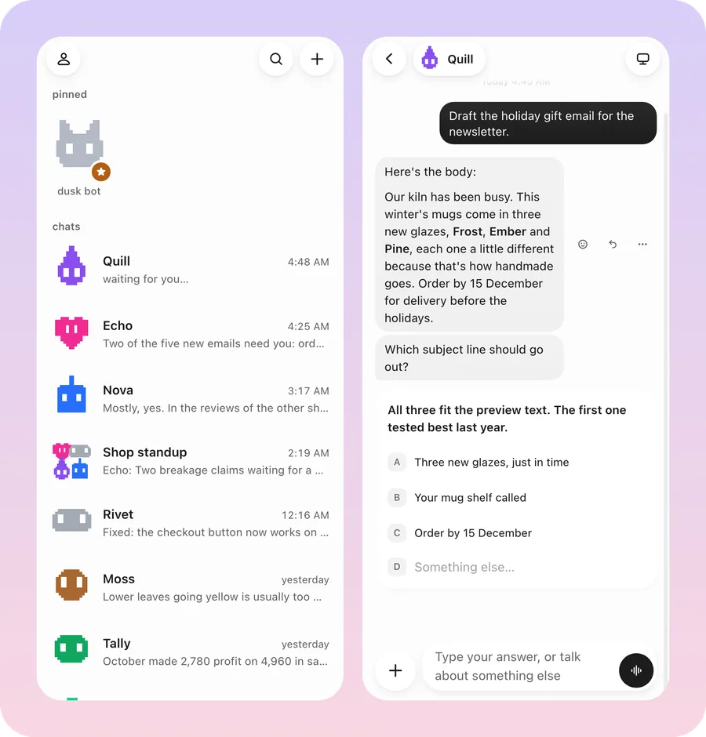</picture>

<picture><source media="(prefers-color-scheme: dark)" srcset="docs/readme/free-dark.webp">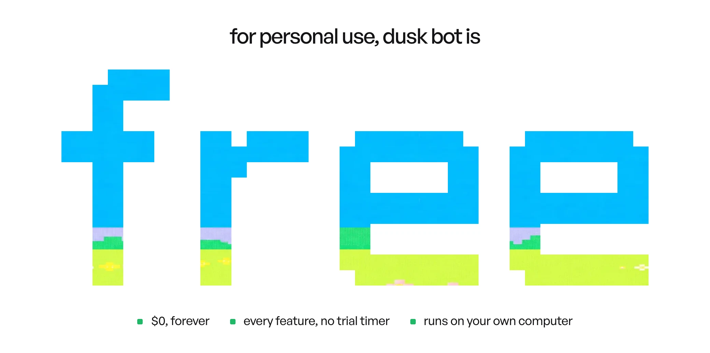</picture>

you pay your ai provider on the plan or key you already have; dusk bot never bills you for ai. bring your own composio key for the long tail of apps. dusk cloud is optional: plus ($20 a month) keeps your bots working with the laptop shut, pro ($50 a month) is a bigger machine with a work license. using dusk bot at or for a business needs a work license. see [pricing](https://dusk.bot/pricing).

<br>

<picture><source media="(prefers-color-scheme: dark)" srcset="docs/readme/how-dark.webp">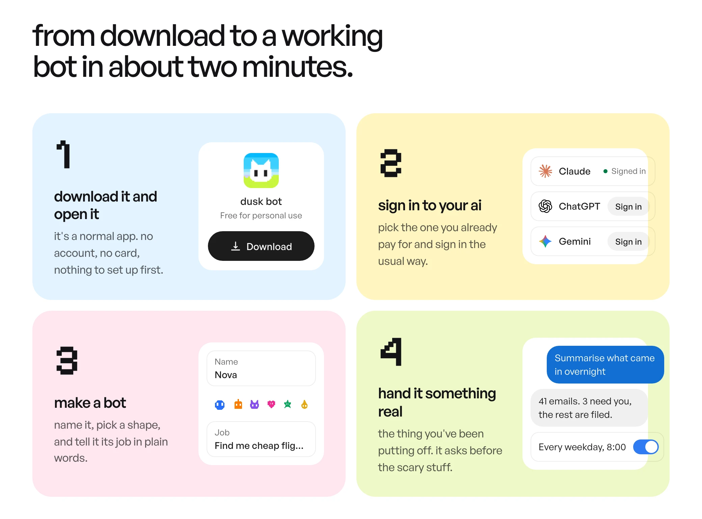</picture>

## install

**mac.** one line in terminal. it downloads this mac's build of the latest release, checks it against `SHA256SUMS`, puts dusk bot in applications and opens it.

```sh
curl -fsSL https://dusk.bot/install-mac | sh
```

prefer the dmg? get it from [the latest release](https://github.com/DuskBotAI/duskbot/releases/latest) (`arm64` for apple silicon, `x64` for intel). it isn't notarized by apple yet, so the first time:

1. open dusk bot, and click **done** when macos says it can't check it.
2. open **system settings**, then **privacy & security**.
3. scroll down, click **open anyway**, and confirm.

**windows.** run `DuskBot-0.2.0-setup.exe` from [the latest release](https://github.com/DuskBotAI/duskbot/releases/latest). windows 10 or 11, 64-bit, no admin rights. if windows says it protected your pc, click **more info**, then **run anyway**.

**linux.** ubuntu 24.04, 64-bit, in beta. get the `.deb` or the `.AppImage` from [the latest release](https://github.com/DuskBotAI/duskbot/releases/latest). see the [linux guide](docs/linux-desktop.md).

```sh
sudo apt install ./DuskBot-*.deb
```

<a name="how-it-fits-together"></a>

<picture><source media="(prefers-color-scheme: dark)" srcset="docs/readme/link-dark.webp">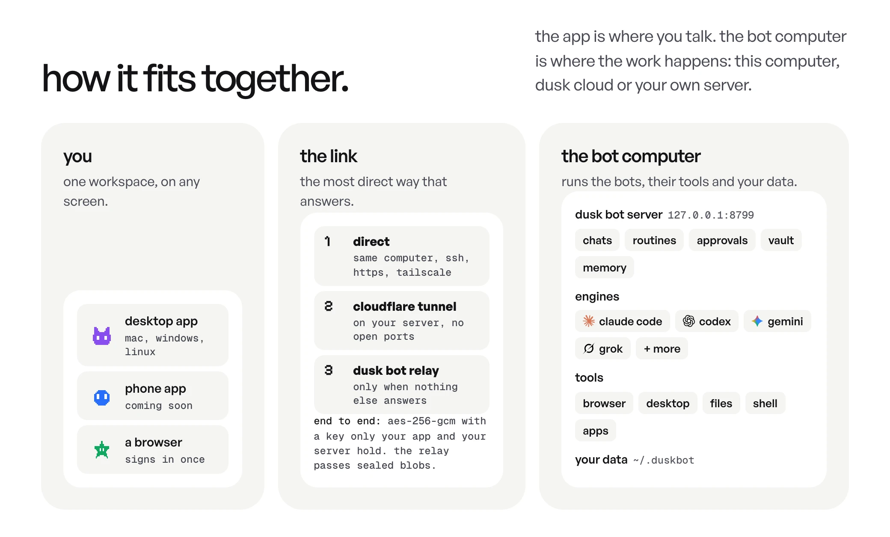</picture>

- **the desktop app** (electron and react) is where you talk. it also owns the local browser views and the desktop driver.
- **the dusk bot server** (node) runs on the bot computer at `127.0.0.1:8799`. it owns chats, routines, approvals, the vault and the engine processes. webhooks get their own listener on the next port.
- **the link** to a remote server tries direct ways first, then the cloudflare tunnel on your server, then the dusk bot relay. frames are sealed with aes-256-gcm using a key only your app and your server hold. see [the link service](apps/link-service/README.md).

## where your data lives

| what | where |
| --- | --- |
| bots, chats, routines, memory, files | `~/.duskbot` on the bot computer (`DUSK_DATA_DIR`), chats in sqlite |
| ai sign-ins and api keys | encrypted with the os keychain on the desktop, or a `0600` key file where there is none |
| vault logins and app tokens | encrypted files in the data folder, keys beside them as `0600` |
| backups | one file, aes-256-gcm, from a password of at least 12 characters |
| what you say to a bot | straight from the bot computer to your ai provider, not through us |
| usage information | anonymous usage counts and crash reports, never your messages or files, on until you turn off "help improve dusk bot" (first screen or Settings). The phone app sends none. [what it sends](docs/analytics.md) |

## security

- **loopback trust.** on your own computer the server trusts loopback as its owner. browsers never get that trust: a browser signs in once, and tunneled or relayed requests need a paired session.
- **pairing.** `duskbot pair` prints a single-use code that lasts 5 minutes. sessions last 30 days and renew on use. five wrong codes lock an address out for 10 minutes.
- **approvals.** each bot has a level, from ask to full access. real questions and missing sign-ins always reach you, and sending in your name has its own setting. see [approval levels](docs/approval-levels.md).
- **secrets stay out of the model.** dusk bot types a saved login in, or hands a secret to a tool, itself. values are redacted from chats and logs.
- **sandboxes.** on your server and on dusk cloud, bots run in a bubblewrap sandbox and bot desktops are separate containers. see [bot box](docs/bot-box.md).
- **what our servers see.** the link service keeps hashed verifiers, public keys and sealed blobs. phone notifications carry a bot's name, never the message.

found a problem? see [SECURITY.md](SECURITY.md).

## self-hosting

run your bots on a server you look after, so they keep working with the laptop shut. it's free. in the app, choose **add a cloud or your own server** and paste the line it gives you on ubuntu 20.04+ or debian 11+:

```sh
curl -fsSL https://dusk.bot/s/<code>/cloudflare | sh   # a cloudflare tunnel (recommended)
curl -fsSL https://dusk.bot/s/<code> | sh              # the dusk bot relay
curl -fsSL https://dusk.bot/s/<code>/tailscale | sh    # your tailnet
curl -fsSL https://dusk.bot/s/<code>/ssh | sh          # over your ssh port
```

it installs dusk bot as `duskbot.service`, links it to your app and sets up the way you picked. the line works once and expires after 30 minutes. by hand: `npx duskbot serve` on any machine with node 24+, then `npx duskbot pair`. docker compose lives in [deploy/](deploy/). never expose port 8799 directly; read [self-hosting](docs/self-hosting.md) first.

## configuration

most settings live in the app. these matter when you run the server yourself:

| variable | what it does |
| --- | --- |
| `DUSK_DATA_DIR` | the data folder. default `~/.duskbot` |
| `DUSK_PORT` | the server port. default `8799` |
| `DUSK_WEBHOOK_PORT` | the webhook listener. default the server port plus one |
| `DUSK_PUBLIC_URL` | the public address in pairing links |
| `DUSK_WEBHOOK_PUBLIC_URL` | the public address in webhook urls |
| `DUSK_LOOPBACK_TRUST` | `owner` (default), or `service` for shared servers |
| `DUSK_SIGNIN_EMAILS` | who may sign in by email on a hosted server |
| `DUSK_URL`, `DUSK_TOKEN` | where the `duskbot` cli connects, and its session |
| `DUSK_BOT_BOX` | turns the bubblewrap sandbox on or off |
| `COMPOSIO_API_KEY` | your own composio key |

## run from source

you need node 24+, pnpm 10, and one ai tool signed in, like [claude code](https://claude.com/claude-code) or [codex](https://github.com/openai/codex).

```sh
git clone https://github.com/DuskBotAI/duskbot.git
cd duskbot
pnpm install
pnpm dev:app          # the desktop app, with the server as its child
```

```sh
pnpm dev:server       # just the server, on 127.0.0.1:8799
pnpm dev              # the app in a browser, on 127.0.0.1:5199
pnpm dev:desktop      # the electron shell against a running server and vite
pnpm demo             # a separate demo workspace with sample bots, on 127.0.0.1:5299
pnpm typecheck        # types for the app and the server
pnpm lint             # oxlint
pnpm test             # the test suites
pnpm package:mac      # a dmg; also package:win and package:linux
```

more in [development](docs/development.md). the images in this readme are rendered from the landing page's own css; see [docs/readme/src](docs/readme/src/render.mjs).

```text
src/              the app ui (react), for the desktop window and the browser
electron/         the desktop shell: windows, the notch island, updates, the desktop driver
server/           the dusk bot server: bots, engines, routines, computers, the vault
shared/           code the app and the server both use
apps/
  mobile/         the phone app (capacitor)
  companion/      the sidecar a phone talks to
  link-service/   pairing and the link for your own server
  cloudflare/     the relay and the composio broker
  dashboard/      the dusk bot account and dusk cloud dashboard
  cloud-service/  dusk cloud desktops
  site/           dusk.bot
skills/           skills that ship with the app
deploy/           docker compose and server deploy files
scripts/          build, test and demo scripts
docs/             guides and references
```

## faq

<details>
<summary><b>is it really free?</b></summary>
<br>
yes, for personal use, with every feature. you only pay for dusk cloud or a work license if you want one.
</details>

<details>
<summary><b>is it safe to let bots click around?</b></summary>
<br>
you set how much each bot may do alone, you can watch or take over at any time, and <code>⌘.</code> stops a bot at once. read the card before you tap allow, especially when it sends, buys or deletes.
</details>

<details>
<summary><b>do my bots work when my laptop is off?</b></summary>
<br>
on this computer, they work while it's awake. put them on dusk cloud or your own server and they keep going, routines included.
</details>

<details>
<summary><b>can i read and change the code?</b></summary>
<br>
yes. dusk bot is source available under the <a href="LICENSE">polyform strict license</a>: read it, run it and build it for personal use. commercial use needs a <a href="https://dusk.bot/license">separate license</a>. details in <a href="docs/LICENSING.md">licensing</a>.
</details>

<details>
<summary><b>is there a dusk bot token or coin?</b></summary>
<br>
no. dusk bot has no token, and any coin using the name has nothing to do with this project.
</details>

## contributing

bug reports, ideas and pull requests are welcome. start with [CONTRIBUTING.md](CONTRIBUTING.md) and the [code of conduct](CODE_OF_CONDUCT.md).

## license

source available under [polyform strict 1.0.0](LICENSE). free for personal use; commercial use needs a [separate license](https://dusk.bot/license).

<br>

<p align="center"><sub>made at dusk. the bots did most of it. <a href="https://dusk.bot">dusk.bot</a></sub></p>
